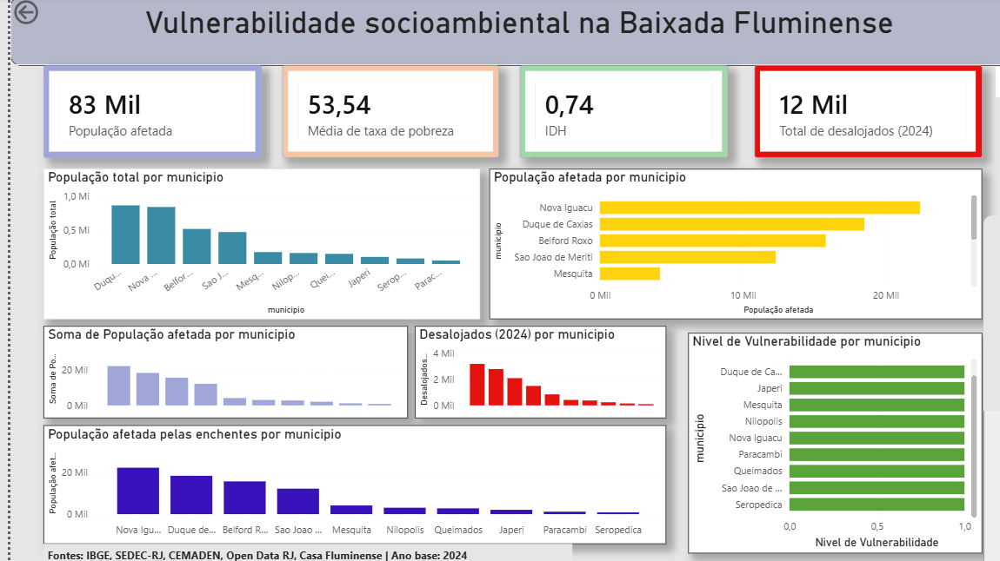

# **📊 Projeto de Análise Socioambiental da Baixada Fluminense**

Este projeto apresenta um **dashboard desenvolvido no Power BI** com foco na análise de indicadores socioambientais da região da **Baixada Fluminense**.

A proposta é utilizar **dados públicos** para explorar e compreender vulnerabilidades sociais e ambientais da região por meio de **visualização de dados e análise estatística**.

---

## **🖼️ Visualização do Dashboard**

*Exemplo de visualização do dashboard desenvolvido no Power BI.*

---

## **📌 Indicadores Analisados**

O dashboard explora os seguintes indicadores:

* **Taxa de pobreza**
* **Índice de Desenvolvimento Humano (IDH)**
* **População afetada por eventos climáticos**
* **Número de desalojados**

Esses indicadores permitem uma visão geral sobre **condições sociais e impactos ambientais** na região.

---

## **🛠 Ferramentas Utilizadas**

* **Power BI** — criação do dashboard e visualização dos dados
* **Microsoft Excel** — organização, limpeza e preparação dos dados para análise

---

## **🎯 Objetivo do Projeto**

Demonstrar habilidades iniciais em:

* **Análise de dados**
* **Interpretação de indicadores sociais**
* **Construção de dashboards**
* **Visualização de dados**

O projeto busca mostrar como a **análise de dados pode contribuir para a compreensão de problemas sociais e ambientais**.

---

## **🎓 Contexto do Projeto**

Este projeto foi desenvolvido como parte do processo de aprendizado na disciplina de **Probabilidade e Estatística**, do curso de **Análise e Desenvolvimento de Sistemas**.

A atividade teve como objetivo **aplicar conceitos estatísticos na análise de dados socioambientais**, permitindo transformar dados em **informações visuais que auxiliam na interpretação de fenômenos sociais reais**.

---

## **📈 Possíveis Melhorias Futuras**

* Inclusão de **novos indicadores socioeconômicos**
* Ampliação da **base de dados**
* Integração com outras ferramentas de análise de dados
* Desenvolvimento de novas análises utilizando **Python** ou **SQL**

Fontes: IBGE, SEDEC-RJ, CEMADEN, Open Data RJ, Casa Fluminense | Ano base: 2024.
